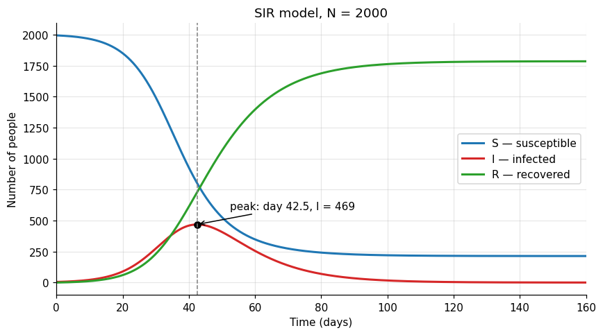
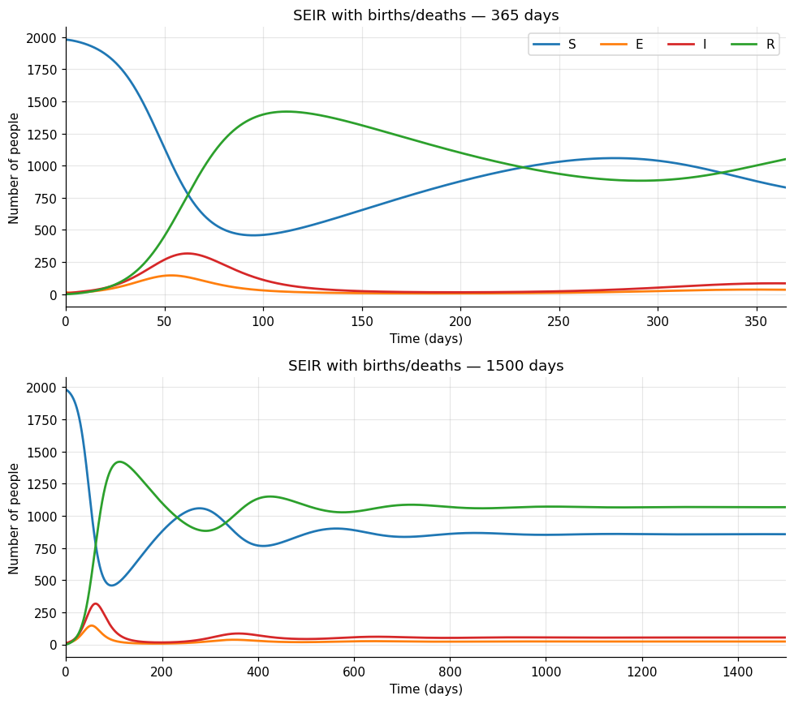
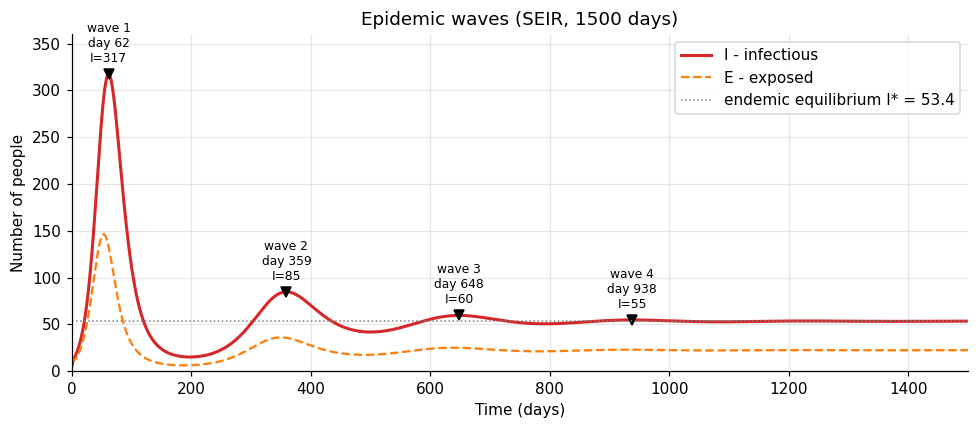
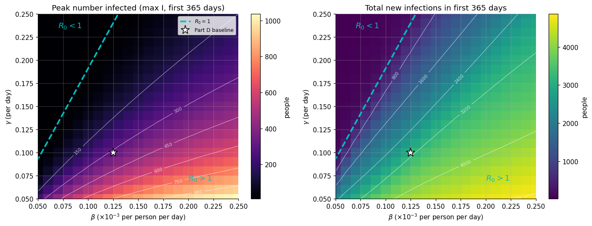

# HW 1 — SIR and SEIR Model Implementation for Pandemic Spread

**Name:** Carol Li
**Email:** xli896@emory.edu  
**Question number:** HW 1, Parts A–E  
**Notebook:** `W7_HW1(1).ipynb`

## Overview

This assignment implements and compares the SIR and SEIR epidemic models. The numerical solutions use a custom forward Euler method and a custom fourth-order Runge–Kutta (RK4) method. The main simulations use RK4 with a time step of 0.1 day. The SEIR model includes a latent (exposed) compartment and births/deaths. A parameter sweep examines the effects of transmission and recovery rates.

## A. Numerical implementation and validation

The notebook implements the Euler and RK4 integrators directly rather than relying on a built-in ODE solver. `scipy.integrate.solve_ivp` is used **only as a verification reference** for the SIR problem. The maximum absolute errors across the S, I, and R compartments were:

| Method | Time step (days) | Maximum absolute error (people) |
|---|---:|---:|
| Euler | 1.0 | 1.07 × 10² |
| Euler | 0.5 | 5.35 × 10¹ |
| Euler | 0.1 | 1.07 × 10¹ |
| RK4 | 1.0 | 4.13 × 10⁻³ |
| RK4 | 0.5 | 2.73 × 10⁻⁴ |
| RK4 | 0.1 | 6.00 × 10⁻⁷ |

RK4 was used for the subsequent simulations because it achieves substantially higher accuracy at the selected time step.

## B–C. SIR simulation and interpretation

**Parameters:** Population `N = 2000`; initial conditions `S(0) = 1995`, `I(0) = 5`, `R(0) = 0`; transmission rate `β = 0.000125` per person per day; recovery rate `γ = 0.1` per day; simulation length 160 days.



**Results and discussion:**

- The infectious population peaks at **day 42.5**, with approximately **469 infectious people** (23.5% of the population).
- The basic reproduction number is **R₀ = βN/γ = 2.50**, so the outbreak initially grows. The mean infectious period is **10 days**.
- Since `dI/dt = I(βS − γ)`, the peak occurs when the susceptible population reaches the threshold **S = γ/β = 800**. The sampled simulation gives approximately **S = 802.1** at the reported peak.
- At day 160, **S ≈ 214.1**, **I ≈ 0.21**, and **R ≈ 1785.7**. Thus approximately **214 people (10.7%)** remain uninfected by day 160.
- The theoretical final-size calculation gives **S(∞) ≈ 214.0**, consistent with the numerical simulation. The epidemic overshoots the threshold at which the effective reproduction number falls below one, because infections already in progress continue to occur.

## D. SEIR model with births and deaths

**Parameters:** `N = 2000`, `S(0) = 1980`, `E(0) = 15`, `I(0) = 5`, `R(0) = 0`, `β = 0.000125`, `γ = 0.1`, exposed-to-infectious progression rate `σ = 0.25` per day, and demographic rate `μ = 0.005` per day. Simulations cover **365** and **1500 days**.

### D(i–ii). Model and trajectories

The model is

```text
dS/dt = μN − βSI − μS
dE/dt = βSI − (σ + μ)E
dI/dt = σE − (γ + μ)I
dR/dt = γI − μR
```



### D(iii). Epidemic waves



The notebook identifies the following infectious peaks in the 1500-day simulation:

| Wave | Peak day | Peak infectious population |
|---|---:|---:|
| 1 | 61.6 | 316.9 |
| 2 | 359.2 | 84.8 |
| 3 | 648.1 | 59.6 |
| 4 | 938.0 | 54.7 |

The mean spacing between these peaks is approximately **292 days**. The initial epidemic is followed by progressively smaller, damped oscillations toward an endemic infectious population of approximately **53 people**. Births replenish the susceptible compartment, allowing further waves after the initial outbreak. The notebook also integrates incidence (`βSI`) between troughs to estimate the number of new infection events during each wave.

### D(iv). Reproduction number and long-term equilibrium

The SEIR basic reproduction number is

`R₀ = βNσ / [(σ + μ)(γ + μ)] = 2.3343`,

compared with **R₀ = 2.5000** in the SIR model. The SEIR value is lower because some exposed individuals die before becoming infectious and mortality shortens the average infectious period. In the absence of mortality (`μ = 0`), this SEIR formula reduces to the SIR value.

The theoretical endemic susceptible population is **S* = N/R₀ = 856.80**. The numerical result at day 1500 is **S(1500) = 856.92**, a difference of only **0.12**. At the endemic equilibrium, the effective reproduction number is one and infections persist at a nonzero level. The idealized critical immune fraction is approximately **57.2%**, assuming homogeneous mixing and perfect immunity; this is not a guarantee of immediate elimination through newborn vaccination.

### D(v). Exposed stage and demographic assumptions

The exposed compartment introduces a mean latent period of **1/σ = 4 days**, delaying infectiousness and affecting the timing of the epidemic. With `μ = 0.005` per day, the assumed mean lifespan is only **200 days**, and births enter the susceptible population at **μN = 10 people per day**. This rapid demographic turnover supports recurrent waves.

The notebook also tests an **80-year lifespan**, corresponding to `μ = 1/(80 × 365) ≈ 3.42 × 10⁻⁵` per day. In that simulation, the initial peak occurs around **day 58**, with approximately **335 infectious people**, and **I(1500) ≈ 2.0 × 10⁻³⁴**. Susceptibles are replenished much more slowly, so no subsequent substantial wave appears during the 1500-day window. In a real finite population, stochastic extinction can occur when case numbers become very small; the deterministic model does not represent that process.

## E. Sensitivity analysis

### E(i–ii). Parameter sweep and heatmaps

The notebook performs **441 SEIR simulations** over 365 days using a **21 × 21** parameter grid:

- Transmission rate: `β = 0.05 × 10⁻³` to `0.25 × 10⁻³` per person per day.
- Recovery rate: `γ = 0.05` to `0.25` per day.

For each parameter combination, it records the **maximum infectious population** and the **cumulative number of new infection events**, calculated by numerically integrating `βSI` over 365 days. The heatmaps include the **R₀ = 1** boundary and the Part D baseline.



### E(iii). Interpretation and public-health implications

Higher transmission rates generally lead to larger infection peaks and more cumulative infections; higher recovery rates reduce both outcomes. The `R₀ = 1` boundary identifies the threshold for sustained transmission in the model. From the baseline, reducing `β` by approximately **57%**, or raising `γ` above approximately **0.240 per day** while holding the other parameters fixed, brings the system below this threshold.

The notebook also compares parameter changes that produce the same `R₀`. At **R₀ ≈ 2.80**, increasing `β` by 20% produces a peak of approximately **408**, whereas reducing `γ` to **0.0825** produces a peak of approximately **433**. Thus `R₀` alone does not uniquely determine peak epidemic burden. Reducing effective contact/transmission and shortening the infectious period are complementary control strategies; vaccination primarily acts by reducing susceptibility, which is not directly varied in this parameter sweep.

## Discussion — hypothesis revisited

**Original hypothesis:** (i) In Part B, the number of infected people will peak around day 40–45 with about 450–500 people infected, because infections first grow while many people are susceptible and then decline as people recover and fewer susceptibles remain. (ii) In Part D, there will be several waves of infection, especially in the 1500-day simulation, because births continuously add new susceptible people and allow the disease to spread again after the first wave; the exposed period delays infections, which may affect the timing of the waves. (iii) In Part E, $\beta$ will have a greater effect on the infection peak than $\gamma$, because a high $\beta$ lets the disease spread quickly and infect many people at the same time, while a high $\gamma$ only reduces the number infected by letting people recover faster.

**Conclusion:** Partly supported. Predictions (i) and (ii) were supported; prediction (iii) was not.

**Evidence and explanation:** (i) The SIR peak occurred on day 42.5 with 469 people infected, inside both predicted ranges, and the mechanism was as expected: infections grow only while $S > \gamma/\beta = 800$ and start to fall once susceptibles drop below that level. (ii) The 1500-day SEIR run showed three distinct waves (days 62, 359 and 648), driven by births refilling the susceptible pool, as predicted. What I did not anticipate was that the waves shrink by a factor of about five each time and settle into an endemic equilibrium of about 53 infected people, rather than repeating at a similar size. The exposed period did affect timing, as I guessed, but by lengthening the generation time to 14 days and hence the spacing between waves (about 290 days), not by creating the waves. (iii) This prediction did not hold. Both parameters act mainly through $R_0 \propto \beta/(\gamma + \mu)$, so changes that move $R_0$ by the same amount have similar effects. Where they differ, lowering $\gamma$ raised the peak slightly more than raising $\beta$ (433 versus 408 at $R_0 = 2.8$), because a longer infectious period lets more cases overlap in time. My intuition that $\beta$ makes the disease spread faster was right, but it shows up in the timing rather than the height: the $\beta$-driven epidemic peaked on day 52 versus day 58. In hindsight, I compared the two parameters by their mechanisms rather than by their effect on $R_0$, which is what actually controls the peak.

## AI usage statement

**Statement: ChatGPT was used to complete this homework. The full chat is available at: (https://chatgpt.com/share/6acfecd6-55e0-83ea-9e57-3843c9da5d8c).**

## How to run

1. Install **Python 3** and JupyterLab or Jupyter Notebook.
2. Place `W7_HW1(1).ipynb`, `requirements.txt`, and this `README.md` in the same project directory.
3. Install the Python dependencies:

   ```bash
   python -m pip install -r requirements.txt
   ```

4. Start Jupyter:

   ```bash
   jupyter lab
   ```

5. Open `W7_HW1(1).ipynb` and choose **Run All**. The notebook creates the `figures/` directory and writes its plots there.

The notebook uses **NumPy**, **Matplotlib**, and **SciPy** (`solve_ivp`, `find_peaks`, and `brentq`), along with the Python standard library. No external data files are required. The custom RK4 solver performs the main numerical integrations; SciPy's ODE solver is used only to validate the SIR integrator.

## Submitted files

```text
README.md
requirements.txt
W7_HW1.ipynb
figures/
    B_sir.png
    D_seir_365_1500.png
    D_waves.png
    E_heatmaps.png
```
